# Sistema Clínico — Diagramas de Classe

Derivado da *Especificação de Requisitos e Documentação Técnica* (RN, RF, RNF e Sprints).
Os diagramas usam **Mermaid** (`classDiagram`). Identificadores sem acento para facilitar o código.

**Como usar:** cada diagrama corresponde a um módulo/Sprint. Implemente na ordem da seção 12.

---

## Status do projeto — onde estamos (revisado contra o código em 27/10/2026)

**Stack:** Flutter · VS Code · Windows (foco atual), Android e Web · Linux fica para depois.
**Fase:** Sprint 1, somente front-end. Os dados ficam **em memória** (somem ao fechar o app): ainda não há servidor, API nem banco.
**Legenda:** ✅ feito · 🟡 parcial · ⬜ pendente

| Etapa | Entrega | Situação | O que falta |
|---|---|---|---|
| 1 | Tela principal: menu adaptável (lateral no PC/Web, gaveta no celular) e painel inicial | ✅ | Painel usa números fictícios |
| 2 | Login e perfis de acesso (RF01.1) | 🟡 | Contas de teste; faltam senha com hash, 2FA e sessão persistente; `LogAcesso` já é gravado em memória (sem tela de consulta) |
| 2 | Menu por perfil (RF01.2) | 🟡 | Regra provisória em `Modulo.perfis`; falta RBAC granular (`Permissao`) |
| 3 | Cadastro de pacientes (RF03.1) | 🟡 | Faltam foto de perfil, endereço e histórico de versões do termo LGPD |
| 3 | Privacidade por profissional (RN03) | 🟡 | Aplicada só no app (vínculo automático pela agenda já funciona); falta no servidor |
| 3.1 | Inativar / excluir paciente e vincular a profissional (pessoa, não cargo) | ✅ | `temHistorico` é provisório até existirem agendamentos e prontuários |
| 4 | Agenda e salas (RF02, RN01, RN02): dia/semana/mês, por sala e por profissional, status, conflitos, vínculo automático | ✅ | `EscalaSala`, `BloqueioAgenda` e revalidação no servidor |
| 5 | **Prontuário (casca por perfil) e Odontograma interativo (RF04.1)** | 🟡 | Odontograma Fases A–D ✅ e E 🟡 (bug nas marcas de arcada). Ortodontia (Fase F) 🟡: ficha não salva/sem datas, fotos placeholder. **HOF, exames, documentos, anamnese e `Prontuario`/`Atendimento`: arquivos existentes estão corrompidos (não compilam); abas mostram "em breve"** |
| — | Servidor (API REST), banco PostgreSQL, criptografia (RNF02) | ⬜ | Entra após as telas da Sprint 1 |
| — | Odontologia: HOF, exames, documentos, anamnese | 🔴 | Reescrever (ver `PROXIMOS_PASSOS_SPRINT1.md`) |
| — | Biomedicina (RF05) | ⬜ | Sprint 1 do PDF, não iniciada |
| — | RN04 (sigilo orçamentário), RN05 (imutabilidade), RN06 (lote) | ⬜ | Dependem de Orçamento, Prontuário e Estoque |
| — | Sprints 2 e 3 (multidisciplinar, estoque, financeiro, WhatsApp, BI) | ⬜ | — |

### Decisões de projeto já tomadas

- **Vínculo por pessoa:** `Paciente.profissionaisVinculados` guarda IDs de `Usuario` (ex.: Dr. Davi), nunca a especialidade. Dois dentistas não compartilham pacientes automaticamente (RN03).
- **Vínculo automático (futuro):** ao agendar, o vínculo é criado sozinho. Vínculo manual serve para encaminhamentos. Vínculo gerado por atendimento realizado não poderá ser removido.
- **Quem vê os vínculos:** só Recepção e Admin. Mostrar a um profissional quem mais atende o paciente vazaria informação.
- **Exclusão:** o caminho normal é **inativar** (mantém o histórico, RN05). Excluir definitivamente só o Administrador e só sem nenhum histórico.
- **Quem cadastra paciente:** só Recepção e Admin (regra provisória em `PoliticaAcessoService.podeEditarPaciente`).
- **Aceite LGPD:** o aceite original (data e versão) nunca é sobrescrito numa edição.
- **Fluxo do agendamento:** paciente → tipo de profissional → procedimento (lista filtrada pelo tipo) → profissional (pessoa) → sala (filtrada por RN01) → data/hora. Os conflitos aparecem ao vivo antes de salvar.
- **Visibilidade da agenda:** Recepção e Admin veem a clínica toda; profissional vê só os próprios atendimentos e só muda o status para Em atendimento/Atendido.
- **Prontuário:** só profissionais de saúde vinculados ao paciente abrem o prontuário; Recepção e Admin não (regra provisória). Cada abertura gera `LogAcesso`.
- **Odontograma:** só dentistas vinculados editam. Os registros são só de inclusão (nunca editados nem apagados); o estado atual é o último registro de cada dente/face.

### Pendências técnicas conhecidas

1. Remover as **contas de teste** e a senha `123456` antes de qualquer uso real (seção 13).
2. Repetir **no servidor** todas as regras de acesso (RN03 etc.): no app elas só escondem telas.
3. Trocar `PacienteRepository` e `AuthService` por chamadas à API quando o servidor existir.
4. Substituir `PacienteRepository.temHistorico` por consulta a atendimentos, evoluções e lançamentos.
5. Foto de perfil do paciente (precisa de pacote de seleção de imagem, junto com o upload de exames).
6. Sessão persistente com expiração, `LogAcesso` no servidor (com IP, imutável e com tela de consulta para o Admin) e 2FA (RNF02).
7. Revalidar os conflitos de agenda **no servidor** (RN01/RN02): dois computadores agendando ao mesmo tempo só são barrados com a validação central.
8. Catálogo de procedimentos, salas e as especialidades de cada perfil estão em constantes (`procedimento.dart`, `sala.dart`, `perfil.dart`); migrar para cadastro/servidor.
9. Odontograma: legenda de cores configurável e vínculo dos registros com `Atendimento` (decíduos já feitos).
10. Arquivos `core/prontuario.dart`, `documentos.dart`, `exames.dart`, `hof.dart` e as `aba_*` correspondentes estão incompletos/corrompidos; reescrever um a um.
11. `marcasArcadaAtivas` não ignora o registro original retificado (desmarcar não persiste).

### Roteiro proposto (próximos passos)

Tamanho relativo: **P** pequeno · **M** médio · **G** grande. A ordem leva em conta o que depende do quê.

| # | Entrega | Tam. | Depende de | Observação |
|---|---|---|---|---|
| 1 | **Odontograma, Fase B:** catálogo de condições (sigla e cor), menu ao tocar no dente, "Adicionar evolução", retificação, visões Atual/Planejado/Realizado | G | Fase A ✅ | Muda o modelo de dados do odontograma |
| 2 | Odontograma, Fases C e D: raízes e dentes decíduos | M | #1 | Raízes usam a divisão horizontal da silhueta |
| 3 | **Prontuário base:** `Prontuario`, `Atendimento`, `Evolucao`, `Adendo`, encerramento do atendimento (RN05) e Anamnese configurável | G | #1 | Tudo o que vem depois (HOF, exames, documentos) se prende ao `Atendimento` |
| 4 | Harmonização Orofacial: ficha, pontos de aplicação, lote, fotos antes/depois | G | #3 | Alimenta o controle de lote (RN06) |
| 5 | Exames: solicitação e upload (JPG/PNG/PDF); foto de perfil do paciente | M | #3 | Precisa de pacote de seleção de arquivo (Windows, Android e Web) |
| 6 | Documentos: prescrição, atestados e TCLE com modelos e PDF | G | #3 | Pacotes de PDF e impressão |
| 7 | Ortodontia, Fases E e F | M + G | #1 | Fase F inclui novos procedimentos na agenda |
| 8 | **Biomedicina (RF05):** anamnese estética, ficha de procedimentos, laudos em PDF | G | #3, #5 | Reaproveita anamnese, exames e lote |
| 9 | Plano de tratamento e orçamento com sigilo para o executante (RN04) | G | #3 | Parte do valor financeiro entra na Sprint 2 |
| 10 | **Marco do servidor:** API REST, banco PostgreSQL, senha com hash, 2FA, `LogAcesso` no servidor, regras RN03/RN04/RN05 e conflitos de agenda aplicados no servidor | G | fim da Sprint 1 | Antes da Sprint 2 (dados financeiros e sensíveis) |

Sprints 2 (multidisciplinar, estoque, financeiro) e 3 (WhatsApp, marketing, BI) seguem o documento de requisitos.

---

## 0. Convenções

- `<<enumeration>>` = enum; `<<abstract>>` = classe abstrata; `<<service>>` = regra de negócio (sem tabela).
- Toda entidade herda de `EntidadeBase` (id, criadoEm, atualizadoEm).
- Tags `RN`/`RF` indicam o requisito atendido.
- Dados sensíveis (psicologia, prontuários) ficam criptografados no banco (RNF02).
- Os títulos de seção levam o status: ✅ feito · 🟡 parcial · ⬜ pendente. Subseções "Implementação atual" mostram o que **de fato existe no código Flutter**.

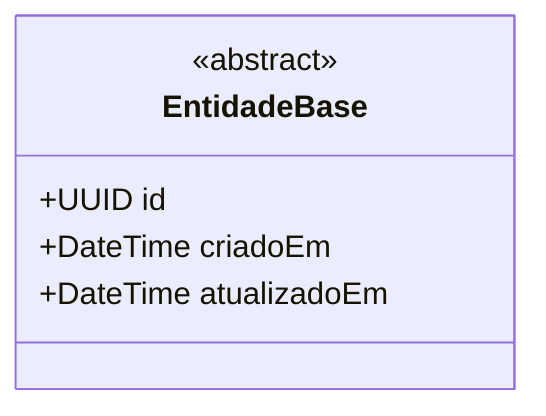

---

## 1. Visão Geral (Domínio)

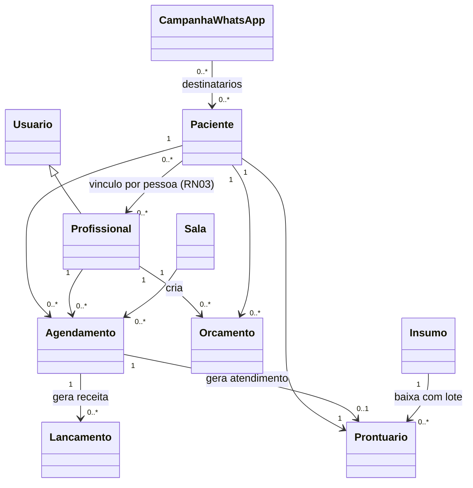

---

## 2. Segurança e Controle de Acesso (RF01, RN03, RNF02, RNF03) — 🟡 parcial

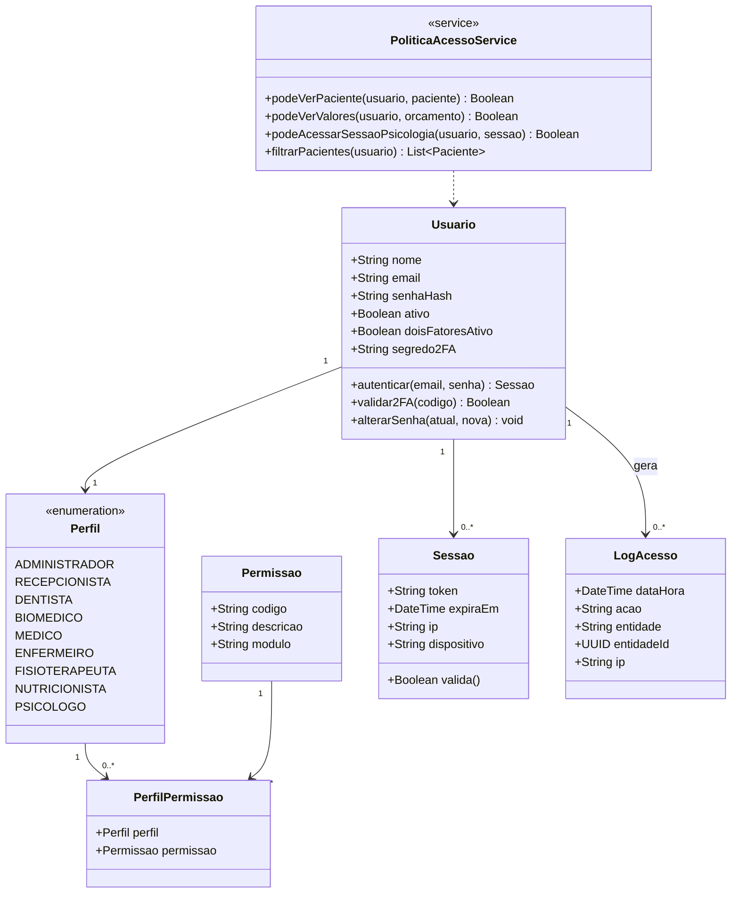

**Regras:** `filtrarPacientes` implementa RN03 (profissional só vê pacientes com agendamento/histórico vinculado; Recepção e Admin veem a lista global). `podeVerValores` implementa RN04.

### Implementação atual (Flutter) 🟡

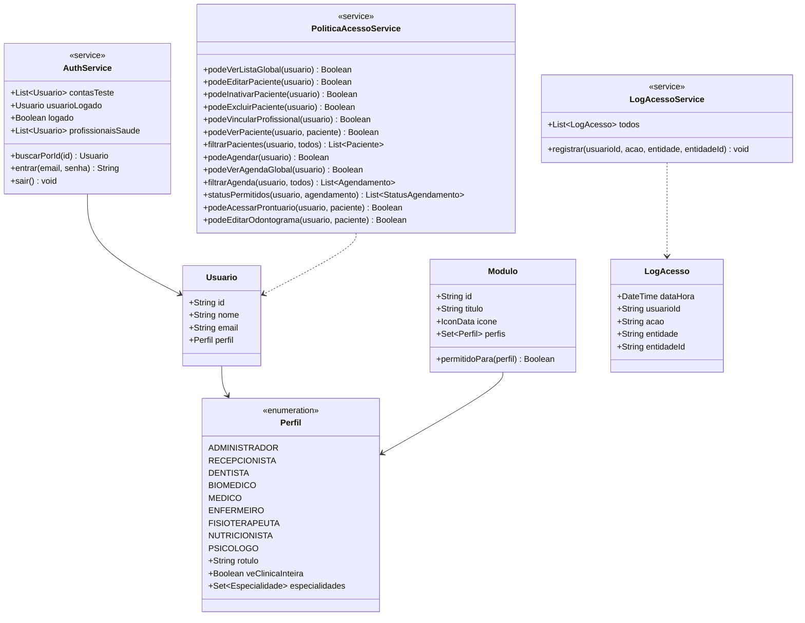

**Diferenças em relação ao diagrama completo acima:**

| Item do diagrama | Situação |
|---|---|
| `senhaHash`, `doisFatoresAtivo`, `segredo2FA`, `validar2FA`, `alterarSenha` | ⬜ Login atual compara com contas de teste (senha `123456`) |
| `Sessao` (token, expiração, IP) | ⬜ Sessão só em memória; `entrar` devolve a mensagem de erro (ou nada, se deu certo) |
| `Permissao`, `PerfilPermissao` | ⬜ Substituídos provisoriamente por `Modulo.perfis` |
| `LogAcesso` | 🟡 `LogAcessoService` em memória, sem `ip` (registra abertura de prontuário e registros do odontograma); falta gravar no servidor e a tela de consulta |
| `podeVerValores` (RN04), `podeAcessarSessaoPsicologia` | ⬜ Dependem de Orçamento e Psicologia |
| `filtrarPacientes(usuario)` | 🟡 Recebe também a lista: `filtrarPacientes(usuario, todos)` |
| Métodos `podeEditar/Inativar/Excluir/VincularProfissional`, `podeAgendar`, `podeVerAgendaGlobal`, `filtrarAgenda`, `statusPermitidos`, `podeAcessarProntuario`, `podeEditarOdontograma` | ✅ Novos (não estavam no diagrama original) |
| `Perfil.especialidades` | ✅ Novo: define o que cada perfil pode atender (usado na agenda) |

---

## 3. Profissionais e Especialidades (RF01.1, RF02.1) — 🟡 parcial

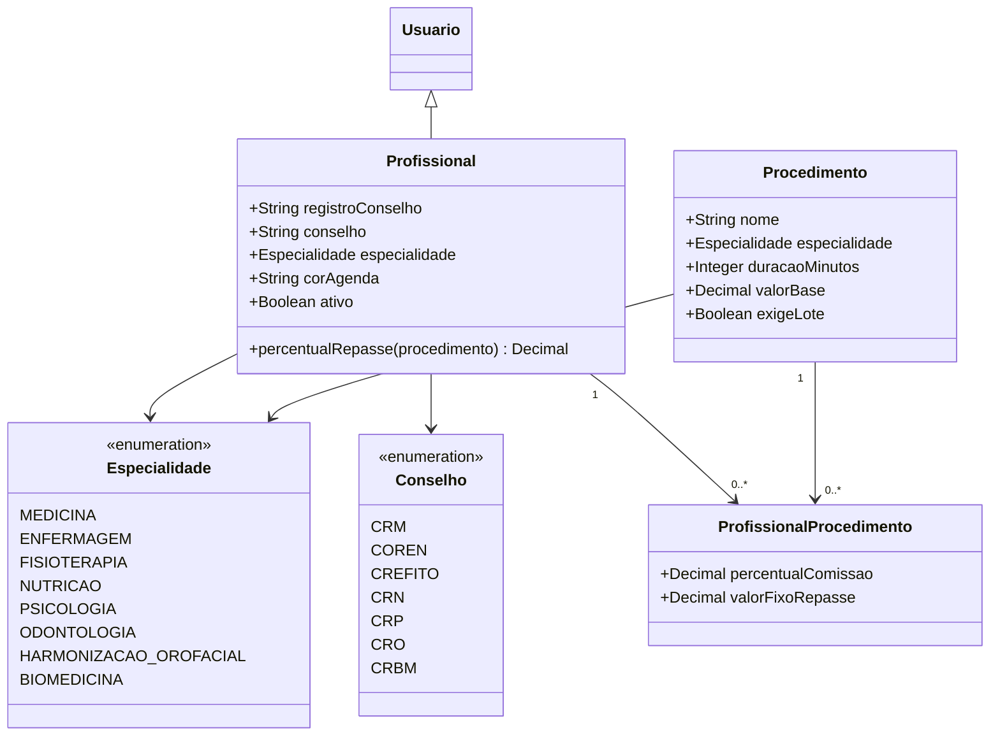

### Implementação atual (Flutter) 🟡

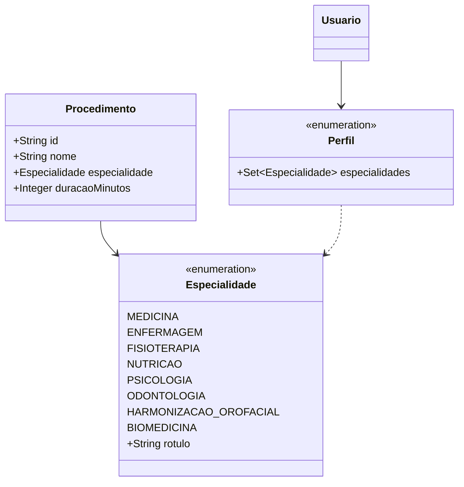

Observações:

- O **profissional ainda é um `Usuario`** com perfil de saúde (`AuthService.profissionaisSaude`). O dentista realiza `ODONTOLOGIA` e `HARMONIZACAO_OROFACIAL`.
- Os procedimentos ficam numa lista constante (`procedimentos`), com busca por `buscarProcedimento(id)`.

| Item do diagrama | Situação |
|---|---|
| `Profissional` (classe própria) com `registroConselho`, `conselho`, `corAgenda`, `percentualRepasse` | ⬜ |
| `Conselho` (enum) | ⬜ |
| `Procedimento.valorBase`, `Procedimento.exigeLote` | ⬜ (entram com Financeiro e Estoque) |
| `ProfissionalProcedimento` (comissão por profissional) | ⬜ |
| `Especialidade`, `Procedimento` (id, nome, especialidade, duração) | ✅ |
| `Perfil.especialidades` (quais especialidades cada perfil atende) | ✅ Novo |

---

## 4. Agenda e Gestão de Salas (RF02, RN01, RN02) — ✅ feito

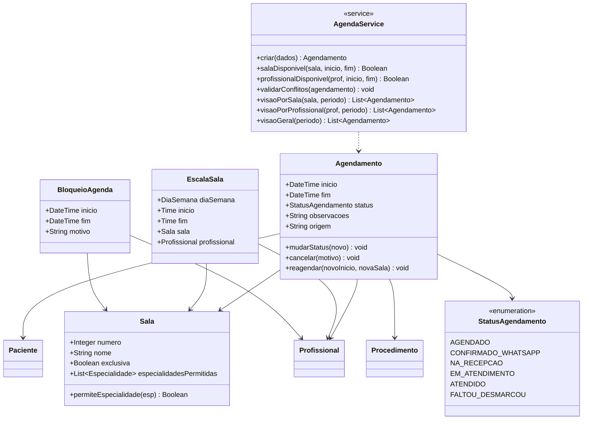

**Regras no `AgendaService.validarConflitos`:**
1. Sala 3 só aceita ODONTOLOGIA/HOF; Sala 4 só BIOMEDICINA; Salas 1 e 2 aceitam Medicina, Enfermagem, Fisioterapia, Nutrição, Psicologia (RN01).
2. Nenhum outro agendamento ativo na mesma sala com sobreposição de horário (RN02).
3. Nenhum outro agendamento ativo para o mesmo profissional em qualquer sala (RN02).
4. Respeitar `EscalaSala` e `BloqueioAgenda`.

### Implementação atual (Flutter) ✅

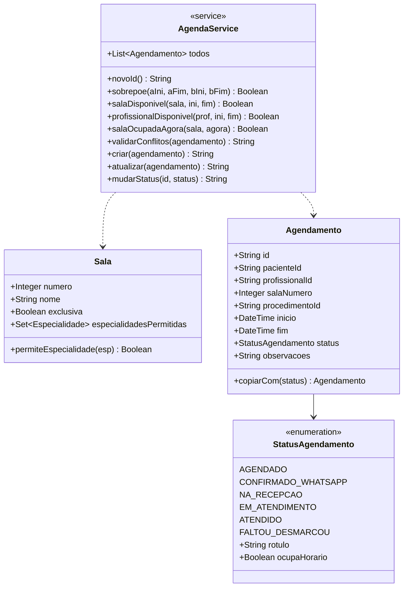

Observações:

- `validarConflitos`, `criar`, `atualizar` e `mudarStatus` devolvem a **mensagem de erro** (ou nulo se deu certo). Ordem das regras: horário final > inicial; profissional realiza a especialidade; sala aceita a especialidade (RN01); sala livre (RN02); profissional livre (RN02).
- `FALTOU_DESMARCOU` libera sala e profissional (`ocupaHorario = false`). Reativar um agendamento desmarcado revalida os conflitos.
- Horários que apenas encostam (09:00–09:30 e 09:30–10:00) não conflitam.
- Ao criar ou editar, `AgendaService` vincula o paciente ao profissional escolhido (RN03, vínculo por pessoa).
- O `Agendamento` guarda **IDs** (`pacienteId`, `profissionalId`, `procedimentoId`), não objetos.
- Testes automáticos: `test/agenda_service_test.dart` (rode `flutter test`).

| Item do diagrama | Situação |
|---|---|
| `EscalaSala`, `BloqueioAgenda` | ⬜ |
| `Agendamento.origem` | ⬜ |
| `cancelar(motivo)` / `reagendar(...)` | 🟡 Cancelar = status Faltou/Desmarcou (sem motivo); reagendar = `atualizar` |
| `visaoPorSala` / `visaoPorProfissional` / `visaoGeral` | 🟡 Feitas na tela (`TelaAgenda`) por filtros, não como métodos do serviço |
| `AgendaService.validarConflitos(agendamento) void` | 🟡 Devolve `String?` com a mensagem de erro |

---

## 5. Pacientes e Prontuário Unificado (RF03, RN05) — 🟡 parcial

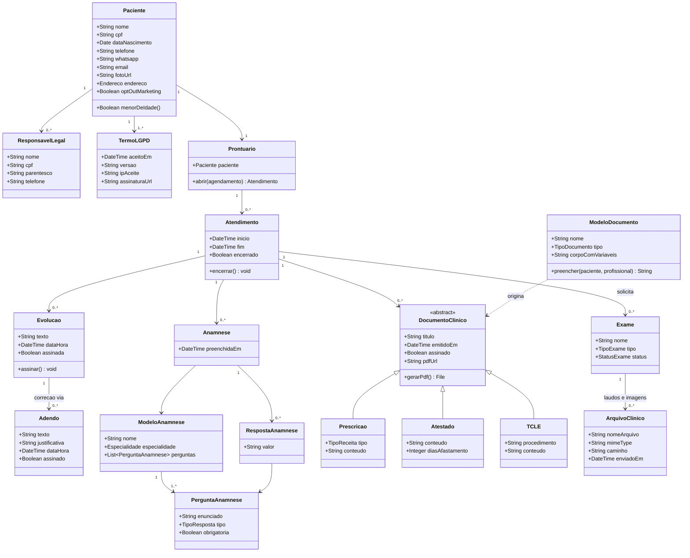

**RN05 (imutabilidade):** `Evolucao`, `DocumentoClinico` e `Exame` assinados/encerrados são *somente leitura* (bloquear UPDATE/DELETE no serviço e no banco). Correção = novo `Adendo` datado e assinado.

### Implementação atual (Flutter) 🟡 — Paciente, Responsável e Termo LGPD

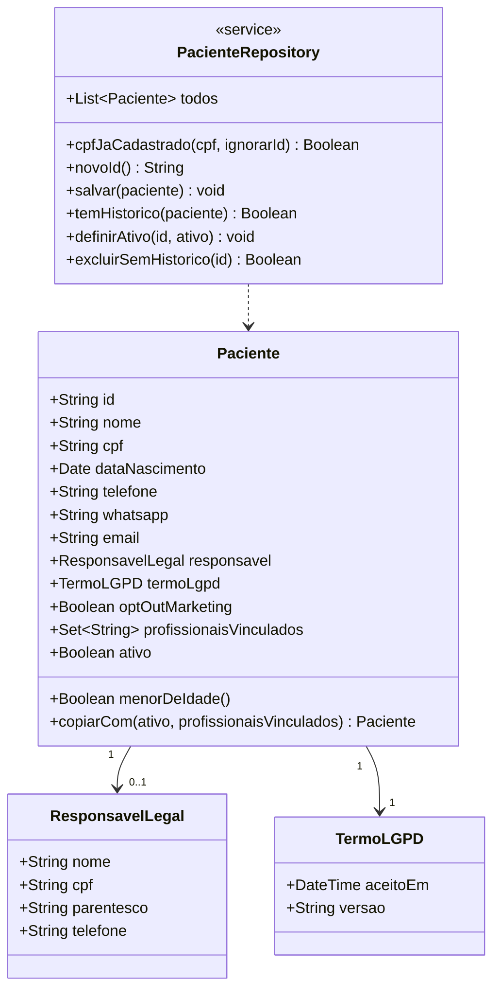

Observações:

- `cpf` e telefones são guardados **só com dígitos**; a formatação (`formatarCpf`, `formatarTelefone`, máscara de digitação e validação de CPF) fica em `core/formadores.dart`.
- `profissionaisVinculados` guarda **IDs de `Usuario`** (pessoa, não especialidade). A seção "Profissionais vinculados" do formulário só aparece para Recepção e Admin.
- `ativo = false` esconde o paciente da lista padrão sem apagar nada (RN05). `excluirSemHistorico` recusa se `temHistorico` for verdadeiro (hoje: tem profissional vinculado; provisório).
- `menorDeIdade` ativa a seção obrigatória de `ResponsavelLegal` no formulário.

**Diferenças em relação ao diagrama completo acima:**

| Item do diagrama | Situação |
|---|---|
| `Paciente.fotoUrl`, `Paciente.endereco` | ⬜ |
| `TermoLGPD`: `ipAceite`, `assinaturaUrl` e múltiplas versões (`1..*`) | ⬜ Hoje é um único aceite por paciente |
| `Prontuario`, `Atendimento`, `Evolucao`, `Adendo` | ⬜ |
| `ModeloAnamnese`, `Anamnese`, `PerguntaAnamnese`, `RespostaAnamnese` | ⬜ |
| `DocumentoClinico` (`Prescricao`, `Atestado`, `TCLE`), `ModeloDocumento` | ⬜ |
| `Exame`, `ArquivoClinico` | ⬜ |
| `Paciente.ativo`, `profissionaisVinculados`, `copiarCom` | ✅ Novos (não estavam no diagrama original) |

---

## 6. Odontologia — Sala 3 (RF04, RN04) — 🟡 parcial

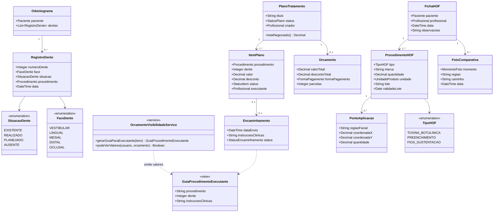

**RN04:** a `GuiaProcedimentoExecutante` nunca contém valores, descontos ou formas de pagamento. Somente `criador` do plano e Administrador acessam `Orcamento`.

### Implementação atual (Flutter) 🟡 — Odontograma (RF04.1)

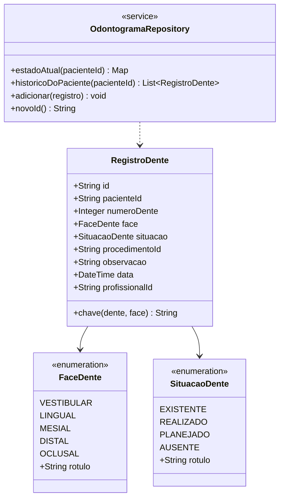

Observações:

- Numeração **FDI**, dentição permanente (11–18, 21–28, 31–38, 41–48). `face = nulo` significa o dente inteiro (usado para Existente/Ausente).
- Cada dente é desenhado com 5 faces em cruz. A face vestibular fica sempre para fora da boca (em cima nos superiores, embaixo nos inferiores); mesial é o lado voltado para a linha média.
- **Só inclusão:** não existe editar nem excluir. O estado atual é o último registro de cada dente/face; o histórico completo fica visível (rastreabilidade, espírito da RN05). Para reverter um dente ausente, registra-se "Existente" no dente inteiro.
- Acesso: só `Perfil.DENTISTA` vinculado ao paciente edita (`podeEditarOdontograma`). Cada registro e cada abertura de prontuário geram `LogAcesso`.
- Telas: `Prontuário` (lista de pacientes vinculados) → `TelaProntuarioPaciente` (abas por perfil; dentista: Odontograma, HOF, Exames, Documentos) → `AbaOdontograma`.
- Testes: `test/odontograma_test.dart`.
- **Fase A do refinamento (✅):** desenho 2D de cada dente (SVGs do repositório, carregados por `CustomPainter` a partir de um JSON gerado por `tool/gerar_dentes_json.dart`) e caixa dividida em 5 setores (quadrada ou redonda). Classes de apoio: `AnatomiaDente`, `DesenhosDentes`, `DenteDesenho`, `CaixaDente`. Plano completo em `melhorias_odontograma.md`.

| Item do diagrama | Situação |
|---|---|
| `RegistroDente` (dente, face, situação, procedimento, data) | ✅ (procedimento por ID; `profissionalId` é novo) |
| `Odontograma` (agregador) | 🟡 Substituído pelo `OdontogramaRepository` |
| `PlanoTratamento`, `ItemPlano`, `Orcamento`, `Encaminhamento`, `GuiaProcedimentoExecutante`, `OrcamentoVisibilidadeService` (RN04) | ⬜ |
| `FichaHOF`, `ProcedimentoHOF`, `PontoAplicacao`, `FotoComparativa`, `TipoHOF` | ⬜ Próxima etapa |
| Dentição decídua (infantil) | ⬜ |

---

## 7. Biomedicina — Sala 4 (RF05) — ⬜ pendente

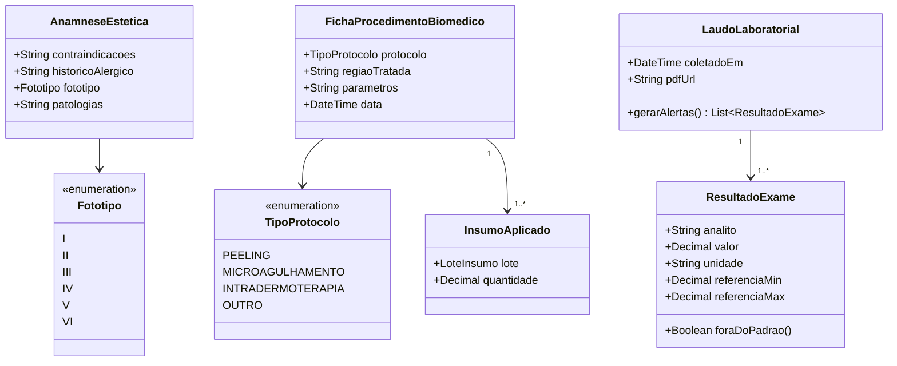

`foraDoPadrao()` = `valor < referenciaMin OR valor > referenciaMax` → sinalização visual (alerta).

---

## 8. Módulo Multidisciplinar — Salas 1 e 2 (RF06) — ⬜ pendente

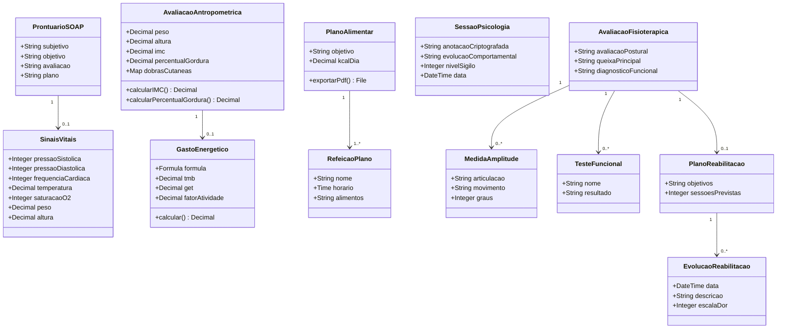

**Psicologia:** `SessaoPsicologia` é criptografada com chave ligada ao psicólogo do caso. Nem Admin nem outros profissionais leem o conteúdo (apenas existência da sessão para fins de agenda).

---

## 9. Estoque e Insumos (RF07, RN06) — ⬜ pendente

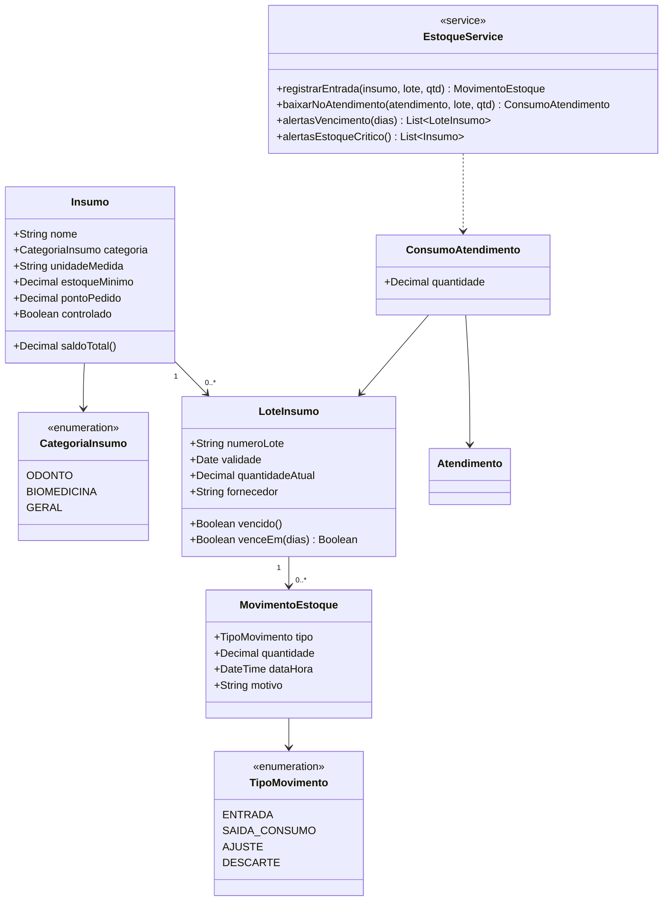

**RN06:** para insumos com `controlado = true` (toxina, preenchedores, anestésicos, reagentes), `baixarNoAtendimento` **exige** lote e validade e lança erro se o lote estiver vencido.

---

## 10. Financeiro (RF08) — ⬜ pendente

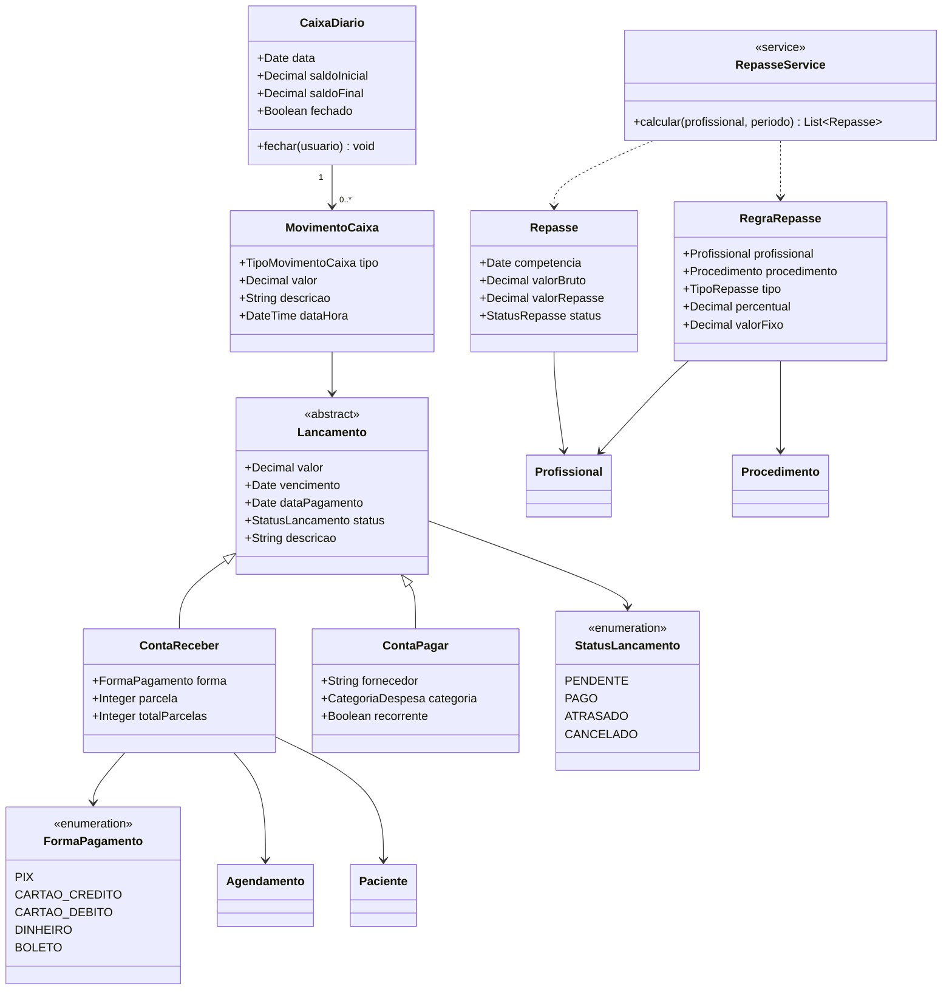

`TipoMovimentoCaixa`: ENTRADA, SAIDA, SANGRIA. Repasse é calculado só sobre atendimentos com status ATENDIDO e receita paga.

---

## 11. WhatsApp, Marketing e BI (RF09, Sprint 3) — ⬜ pendente

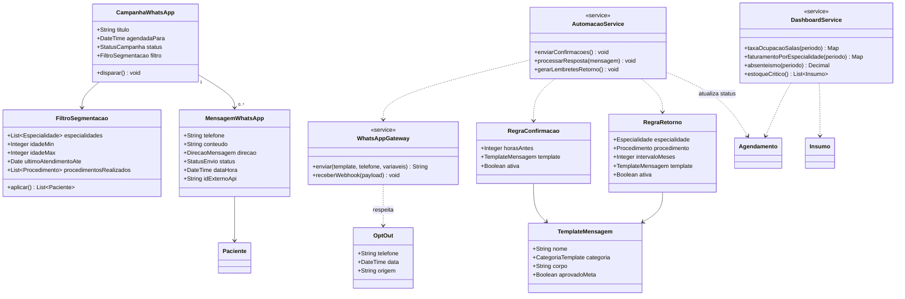

**Resposta do paciente:** `[1] Confirmar` → `CONFIRMADO_WHATSAPP`; `[2] Cancelar` → `FALTOU_DESMARCOU`; palavra “SAIR/PARAR” → cria `OptOut`. Toda campanha exclui números com `OptOut`.

---

## 12. Arquitetura em Camadas e Ordem de Implementação — 🟡 em andamento

Para cumprir *local + rede wifi + web + desktop/mobile*: um **servidor único** (API REST) na máquina da clínica, banco local, e um **app Flutter** (Windows, Android e Web, mesma base de código) que fala com a API, usado no PC, tablet ou celular, via `http://IP-do-servidor` na rede local ou via domínio/VPN para acesso externo.

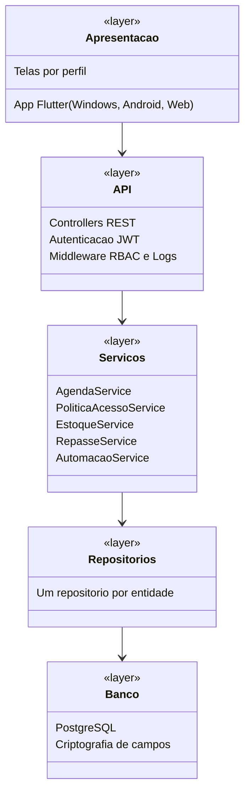

### Procedimento de desenvolvimento (por Sprint)

**Sprint 1 — Core + Odonto + Biomed**
1. ⬜ Criar `EntidadeBase`, banco e migrações.
2. 🟡 Implementar diagrama **2** (Usuario, Perfil, Permissao, Sessao, LogAcesso, `PoliticaAcessoService`). Testar RN03/RN04 antes de seguir.
3. 🟡 Implementar diagrama **3** (Profissional, Especialidade, Procedimento).
4. 🟡 Implementar diagrama **5** parcial: Paciente, ResponsavelLegal, TermoLGPD, Prontuario, Atendimento, Evolucao, Adendo, Anamnese.
5. ✅ Implementar diagrama **4** (Sala, Agendamento, `AgendaService`). Escrever testes automáticos de conflito (mesma sala, mesmo profissional, sala exclusiva).
6. 🟡 (em andamento: odontograma pronto) Implementar diagrama **6** (Odontologia) e **7** (Biomedicina).
7. ⬜ Implementar DocumentoClinico, ModeloDocumento, Exame e ArquivoClinico (diagrama **5**).

**Sprint 2 — Multidisciplinar, Estoque, Financeiro**
8. ⬜ Diagrama **8** (SOAP, Nutrição, Psicologia com criptografia, Fisioterapia).
9. ⬜ Diagrama **9** (Estoque) e ligar `baixarNoAtendimento` aos prontuários de HOF e Biomedicina (RN06).
10. ⬜ Diagrama **10** (Financeiro, Caixa, Repasse).

**Sprint 3 — WhatsApp, Marketing, BI**
11. ⬜ Diagrama **11**: `WhatsAppGateway` (API oficial), confirmações, regras de retorno, campanhas, opt-out.
12. ⬜ `DashboardService` e painéis.

**Notas sobre o andamento:**
- Passo 2: login, perfis e `PoliticaAcessoService` existem (seção 2); faltam hash de senha, 2FA, `Sessao`, `LogAcesso` e as permissões granulares.
- Passo 3: `Especialidade` e `Procedimento` existem (seção 3); o profissional ainda é um `Usuario`; faltam `Conselho`, `registroConselho` e comissões.
- Passo 5: agenda pronta, com testes automáticos de conflito (seção 4).
- Passo 6: odontograma interativo pronto (seção 6); faltam HOF, plano de tratamento/orçamento (RN04) e Biomedicina.
- Passo 4: `Paciente`, `ResponsavelLegal` e `TermoLGPD` prontos (seção 5); faltam `Prontuario`, `Atendimento`, `Evolucao`, `Adendo` e `Anamnese`.
- Passo 1: sem banco nem migrações; os dados vivem em memória.

### Checklist de validação final
- [ ] Nenhuma tela de profissional lista pacientes sem vínculo (RN03). *🟡 feito no app; falta aplicar no servidor.*
- [ ] Executante nunca recebe valores (RN04).
- [ ] Registros assinados não podem ser editados/excluídos (RN05).
- [ ] Baixa de insumo controlado exige lote e validade (RN06).
- [ ] Todo acesso a prontuário gera `LogAcesso` (RNF03). *🟡 gravado em memória no app; falta o servidor e uma tela de consulta.*
- [ ] Telas carregam em menos de 2 s (RNF01).

---

## 13. Mapa de código Flutter (o que existe hoje) ✅

Pasta `lib/` do projeto:

| Arquivo | Conteúdo | Seção deste documento |
|---|---|---|
| `main.dart` | `SistemaClinicoApp`; troca login/tela principal conforme `auth.logado` | 12 |
| `core/perfil.dart` | `Perfil` (enum), `veClinicaInteira`, `especialidades` | 2 |
| `core/usuario.dart` | `Usuario` | 2 |
| `core/auth_service.dart` | `AuthService`, instância global `auth`, contas de teste | 2 |
| `core/modulos.dart` | `Modulo` e a lista de módulos do menu por perfil | 2 |
| `core/politica_acesso_service.dart` | `PoliticaAcessoService`, instância `politicaAcesso` | 2 |
| `core/paciente.dart` | `Paciente`, `ResponsavelLegal`, `TermoLGPD` | 5 |
| `core/paciente_repository.dart` | `PacienteRepository`, instância `pacientes` (dados de exemplo) | 5 |
| `core/formadores.dart` | Formatação, validação de CPF, datas e horas, `MascaraFormatter` | 5 |
| `core/especialidade.dart` | `Especialidade` (enum) | 3 |
| `core/procedimento.dart` | `Procedimento` e catálogo provisório | 3 |
| `core/sala.dart` | `Sala` e as 4 salas (RN01) | 4 |
| `core/agendamento.dart` | `Agendamento`, `StatusAgendamento` | 4 |
| `core/agenda_service.dart` | `AgendaService`, instância `agenda` (conflitos RN01/RN02) | 4 |
| `core/odontograma.dart` | `FaceDente`, `SituacaoDente`, `RegistroDente`, numeração FDI | 6 |
| `core/odontograma_repository.dart` | `OdontogramaRepository`, instância `odontogramas` | 6 |
| `core/anatomia_dente.dart` | `AnatomiaDente` (validação FDI, espelhamento, nomes) | 6 |
| `core/desenhos_dentes.dart` | `DesenhosDentes`, `DesenhoDente` (carrega os desenhos do JSON) | 6 |
| `core/log_acesso.dart` | `LogAcesso`, `LogAcessoService`, instância `logsAcesso` | 2 |
| `telas/tela_login.dart` | Login (RF01.1) | 2 |
| `telas/tela_principal.dart` | Menu adaptável, conta/sair | 2 |
| `telas/painel_inicial.dart` | Painel com resumo do dia e salas (dados reais da agenda) | 1 |
| `telas/tela_modulo_em_construcao.dart` | Tela provisória dos módulos sem implementação | — |
| `telas/pacientes/tela_pacientes.dart` | Lista, busca, filtro de inativos | 5 |
| `telas/pacientes/tela_form_paciente.dart` | Cadastro, edição, vínculos, inativar/excluir | 5 |
| `telas/agenda/tela_agenda.dart` | Agenda: dia/semana/mês, por sala/profissional, status | 4 |
| `telas/agenda/tela_form_agendamento.dart` | Novo/editar agendamento (tipo → procedimento → profissional → sala) | 4 |
| `telas/prontuario/tela_prontuario.dart` | Lista de pacientes com prontuário acessível | 5 |
| `telas/prontuario/tela_prontuario_paciente.dart` | Prontuário com abas por perfil e registro de acesso | 5 |
| `telas/prontuario/aba_odontograma.dart` | Odontograma interativo (RF04.1) | 6 |
| `core/condicao_odonto.dart` | `CondicaoOdonto`, `AlvoOdonto`, `StatusTratamento`, `MarcaOrtodontia` | 6 |
| `core/odontograma.dart` (inclui modelos e `OrtodontiaRepository` da Fase F) | ✅ / 🟡 | 6 |
| `telas/prontuario/menu_condicoes.dart`, `dialogo_evolucao.dart` | Menu de condições e evolução/retificação | 6 |
| `telas/prontuario/aba_ortodontia*.dart` | Ortodontia (🟡: não salva, sem datas) | 6 |
| `core/prontuario.dart`, `documentos.dart`, `exames.dart`, `hof.dart` e `telas/prontuario/aba_{prontuario,anamnese,exames,hof,documentos}*.dart` | 🔴 incompletos, **não compilam**, não ligados à tela | 5/6 |
| `telas/prontuario/desenho_dente.dart` | `DenteDesenho`: desenho 2D do dente | 6 |
| `telas/prontuario/caixa_dente.dart` | `CaixaDente` e `faceNoPonto`: caixa dividida e toque por face | 6 |
| `tool/gerar_dentes_json.dart` | Gera `dentes_vestibular.json` a partir dos SVGs | 6 |
| `test/agenda_service_test.dart` | Testes de conflito de agenda | 4 |
| `test/odontograma_test.dart` | Testes do odontograma e do acesso ao prontuário | 6 |
| `test/anatomia_dente_test.dart` | Testes da numeração FDI e do espelhamento | 6 |
| `test/caixa_dente_test.dart` | Testes do toque por face (quadrada e redonda) | 6 |

### Contas de teste (REMOVER antes de uso real)

Senha de todas: `123456`.

| Perfil | E-mail | ID |
|---|---|---|
| Administrador | `admin@clinica.local` | 1 |
| Recepcionista | `recepcao@clinica.local` | 2 |
| Dentista (Dr. Davi) | `dentista@clinica.local` | 3 |
| Dentista (Dra. Lúcia) | `dentista2@clinica.local` | 10 |
| Biomédico | `biomedico@clinica.local` | 4 |
| Médico | `medico@clinica.local` | 5 |
| Enfermeiro | `enfermeiro@clinica.local` | 6 |
| Fisioterapeuta | `fisio@clinica.local` | 7 |
| Nutricionista | `nutri@clinica.local` | 8 |
| Psicólogo | `psicologo@clinica.local` | 9 |
