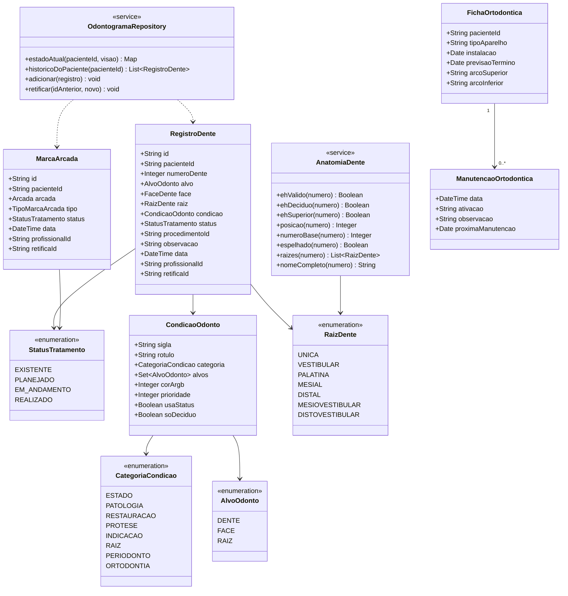

# Refinamento do Odontograma — Especificação

**Requisito de origem:** RF04.1 (Odontograma Interativo) · **Módulo:** Odontologia (Sala 3)
**Data:** 24/10/2026 · **Stack:** Flutter (Windows, Android e Web)
**Ponto de partida:** `aba_odontograma.dart` (caixas em cruz, sem desenho do dente, situações Existente/Realizado/Planejado/Ausente, só dentição permanente).
**Assets:** os SVGs já estão no repositório; ver `GUIA_USO_SVGS_ODONTOGRAMA.md` (pacotes do hemiarco direito e esquerdo, ids, manifest e receitas).

Este documento descreve **o que** vai mudar e **em que ordem** implementar. Cada fase termina com critérios de aceite e testes. Legenda: ✅ decidido · ❓ precisa de confirmação · 🧪 teste automático.

---

## 1. Resumo das mudanças

| # | Pedido | O que muda | Fase | Muda os dados? |
|---|---|---|---|---|
| 1 | Desenho 2D do dente sobre cada caixa | Imagem (coroa + raiz) de cada um dos 32 dentes | A | Não |
| 2 | Caixa quadrada/redonda dividida por dentro | Troca a "cruz" por uma caixa com setores (face vestibular, lingual, mesial, distal e oclusal) | A | Não |
| 3 | Marcar o dente com evolução, letra e/ou cor | Catálogo de condições com sigla e cor, menu ao tocar no dente, botão "Adicionar evolução" | B | **Sim** |
| 4 | Dentes decíduos | Caixa de seleção "Mostrar dentes decíduos" e faixa central com 20 dentes | D | Pequena (novos números de dente) |
| 5 | Tratamentos de raiz | Marcação por raiz (endodontia, periodontia etc.) | C | **Sim** |
| 6 | Ortodontia | Aparelho desenhado no dente e na arcada, e depois ficha ortodôntica própria | E e F | **Sim** |

Ordem recomendada: **A → B → C → D → E → F**. A fase A não altera dados e dá resultado visual imediato.

---

## 2. Referências visuais (imagens enviadas)

| Imagem | O que aproveitar | O que **não** copiar |
|---|---|---|
| 1 | Estilo dos desenhos (coroa clara, raiz bege, sombreado leve); restaurações coloridas sobre a coroa; **braquetes** desenhados no dente (ortodontia) | Os arquivos de imagem em si |
| 2 | **Ordem vertical:** desenho → número → caixa redonda dividida; cor azul para dente marcado; ícone de marcação no dente | Marca, logotipo e imagens |
| 3 | Caixas **quadradas** (quadrado dentro de quadrado); **faixa de decíduos** no meio; caixas "Prótese total superior/inferior"; seletor "Odontograma: Atual" | Marca e imagens |
| 4 | **Menu de condições** em duas colunas, com sigla entre parênteses, e botão azul "Adicionar evolução" | Marca e imagens |

> ⚠️ **Direitos autorais.** As imagens de referência pertencem a terceiros. O sistema deve usar desenhos **próprios** (criados para a clínica) ou de banco com licença que permita uso comercial. Não recortar nem reaproveitar os arquivos das referências.

---

## 3. Layout geral (decidido ✅)

Segue a Imagem 2: o **desenho fica para fora**, o **número fica entre o desenho e a caixa** e as **caixas ficam para o centro**. Assim, o desenho do dente superior fica acima da caixa e o do inferior fica abaixo, como nas referências.

```
 [ ] Mostrar dentes decíduos     Visão: [Atual ▾]     [ ] Prótese total sup.   [ ] Prótese total inf.

    desenho (raiz p/ cima)   18  17  16  15  14  13  12  11 │ 21  22  23  24  25  26  27  28
    número                   18  17  16  15  14  13  12  11 │ 21  22  23  24  25  26  27  28
    caixa                    ▣   ▣   ▣   ▣   ▣   ▣   ▣   ▣  │ ▣   ▣   ▣   ▣   ▣   ▣   ▣   ▣
  ─ ─ ─ ─ ─ ─ ─ ─ ─  faixa dos decíduos (só se marcada)  ─ ─ ─ ─ ─ ─ ─ ─ ─
    caixa                    ▣   ▣   ▣   ▣   ▣   ▣   ▣   ▣  │ ▣   ▣   ▣   ▣   ▣   ▣   ▣   ▣
    número                   48  47  46  45  44  43  42  41 │ 31  32  33  34  35  36  37  38
    desenho (raiz p/ baixo)  (imagens dos dentes inferiores)
```

- A linha vertical `│` é a linha média (hoje já existe um espaço de 20 px).
- Largura total de uma arcada: 16 dentes × ~44 px + espaço central ≈ 720 px. Em telas estreitas continua a **rolagem horizontal**; opcionalmente, o botão "Ajustar à tela" reduz o conjunto.
- ❓ Se preferir **todos os desenhos acima das caixas** (inclusive os inferiores), é só inverter o bloco inferior. Mas o dente inferior ficaria entre as duas arcadas, o que difere das referências.

---

## 4. Item 1 — Desenho 2D de cada dente

### 4.1 Comportamento
- Cada dente mostra uma **vista vestibular** (de frente) com **coroa e raiz**.
- Dentes superiores: raiz para cima. Dentes inferiores: raiz para baixo. A vista vestibular dos SVGs já vem assim (não precisa espelhar na vertical).
- O lado esquerdo da boca usa o desenho do lado direito **espelhado na horizontal** (21 = 11, …, 28 = 18; 31 = 41, …, 38 = 48), como o pacote esquerdo do repositório já é.
- O desenho é composto por **duas camadas** (coroa e raiz), para que cada uma possa receber cor própria (itens 3, 5 e 6).

### 4.2 Desenhos que já existem (repositório) ✅
Segundo o `GUIA_USO_SVGS_ODONTOGRAMA.md`:
- Dois pacotes: hemiarco **direito** (18–11 e 48–41) e **esquerdo** (21–28 e 31–38, espelho do direito).
- Cada dente tem 3 vistas (incisivos e caninos, 2) e 3 partes por vista: `completo`, `coroa` e `raiz`. Superiores: vestibular, oclusal*, palatina. Inferiores: lingual, oclusal*, vestibular. (*só pré-molares e molares, só coroa.)
- Cada parte tem um `fundo` (silhueta branca, usada para pintar e para detectar toque) e as `linhas` (contorno preto). Sem CSS, gradientes ou imagens embutidas.
- Coroa, raiz e completo da mesma vista têm o **mesmo `viewBox`**, então se empilham sem deslocamento.

| Vista | Uso no odontograma | Fase |
|---|---|---|
| Vestibular (coroa + raiz) | Desenho principal junto à caixa | A |
| Oclusal (só pré-molares e molares) | Opcional: painel ampliado do dente no celular | depois |
| Palatina / lingual | Não usadas por enquanto | — |

Como o lado esquerdo é espelho do direito, o app só precisa do **pacote direito**: 16 dentes × coroa e raiz = **32 SVGs** (vista vestibular).

### 4.3 Como carregar os desenhos (decidido ✅)
- **`CustomPainter` + `path_drawing`** (recomendado pelo guia): permite pintar só a silhueta (`fundo`) e testar toque por região (`path.contains`). O `flutter_svg` pintaria o desenho inteiro.
- **Pré-processamento:** a ferramenta `tool/gerar_dentes_json.dart` lê os 32 SVGs e grava um único `lib/assets/odontograma/dentes_vestibular.json`. Assim o `pubspec.yaml` declara **1 arquivo** (a declaração de pastas do Flutter não é recursiva e seriam 16 linhas) e o app lê tudo de uma vez.
- **Escala e alinhamento:** a mesma escala para todos (0,38 px por unidade do SVG), então o molar fica maior que o incisivo. Superiores alinhados pela borda de baixo (junto à caixa), inferiores pela de cima. Área de cada dente: 38 × 64 px.
- **Se o JSON faltar,** o odontograma continua funcionando só com as caixas e mostra um aviso.

**Pendências herdadas dos SVGs (guia, seção 8):**
- Contornos com leve irregularidade (a origem é uma imagem raster de 512×787 px vetorizada).
- Artefatos conhecidos em 14/24, 48/38, 47/37 e 46/36.
- Raízes de pré-molares e molares estão **unidas em uma só silhueta** (a Fase C divide por região horizontal).
- **Não há dentes decíduos** (a Fase D reaproveita os permanentes em escala menor).
- ❓ Confirmar a **origem e a licença** da imagem raster usada na vetorização, já que o sistema será usado comercialmente.

### 4.4 Tamanho e estados visuais
- Área do desenho: 38 × 64 px, com escala comum a todos os dentes (ver 4.3).
- **Dente ausente/extraído:** desenho com opacidade 25% e um X sobre ele.
- Passar o mouse mostra o nome completo (ex.: "16 — Primeiro molar superior direito").
- Acessibilidade: cada dente tem descrição de texto (`Semantics`).

### 4.5 Interação
- **Tocar na coroa** ou no **número**: abre o menu de condições do dente inteiro (item 3).
- **Tocar na raiz:** abre o menu de condições de raiz (item 5).
- **Tocar em um setor da caixa:** abre o menu de condições de face.

---

## 5. Item 2 — Caixa dividida (quadrada ou redonda)

### 5.1 Aparência
- Caixa **quadrada com quadrado interno**: o quadrado central é a face **oclusal/incisal**; os quatro trapézios ao redor são **vestibular, lingual, mesial e distal**, separados pelas diagonais.
- Opção **redonda**: círculo com círculo interno, dividido pelas mesmas diagonais.
- ✅ Padrão: **quadrada**. Estilo configurável em `Configurações` (futuro); a primeira versão traz uma constante.
- A posição de cada face segue a regra que já usamos: a face vestibular fica sempre para **fora** da boca (em cima nos superiores, embaixo nos inferiores) e a mesial fica voltada para a linha média.

### 5.2 Como descobrir o setor tocado
Coordenadas normalizadas `x, y` de 0 a 1 dentro da caixa; `dx = x − 0,5` e `dy = y − 0,5`.

| Estilo | Regra |
|---|---|
| Quadrada | Centro se `|dx| < 0,2` **e** `|dy| < 0,2`; senão, `|dx| > |dy|` → lado esquerdo/direito, caso contrário → topo/base |
| Redonda | Fora se `dx² + dy² > 0,25`; centro se `dx² + dy² < 0,05`; senão, mesma regra de diagonais |

Uma função pura `faceNoPonto(Offset, Size, estilo, ...)` devolve a `FaceDente?`, o que permite 🧪 testes sem abrir a tela.

### 5.3 Cor e letra dentro da caixa
- Cada setor é preenchido com a **cor da condição de face** mais recente naquele setor.
- Se houver uma marcação do **dente inteiro**, a sigla aparece centralizada ou em um selo no canto, além da cor.
- Nunca depender só da cor: sempre sigla ou ícone (daltonismo).

### 5.4 Telas pequenas (celular)
Caixa de 38 px é difícil de tocar. Em largura < 600 px, tocar no dente abre um **painel ampliado** com o desenho grande e a caixa de ~160 px para escolher o setor.

---

## 6. Item 3 — Condições, evolução, letra e cor

### 6.1 Como funciona (inspirado na Imagem 4)
1. O profissional toca no dente (coroa, número, raiz ou setor da caixa).
2. Abre um **menu** (janela no PC/Web, folha inferior no celular) com as condições aplicáveis ao alvo tocado, em duas colunas, com a sigla.
3. Escolher uma condição **registra** a marcação (pede o status e o procedimento quando fizer sentido).
4. O botão **"Adicionar evolução"** abre o formulário completo: condição, alvo (dente, face ou raiz), status do tratamento, procedimento, observação e data.
5. O dente passa a exibir a **sigla** (selo) e a **cor** da condição.

### 6.2 Catálogo inicial de condições (da Imagem 4)
Alvo: **D** = dente inteiro · **F** = face · **R** = raiz. As cores são sugestões, e as siglas e cores devem ser validadas pela equipe de dentistas (❓).

| Sigla | Condição | Alvo | Categoria | Cor sugerida | Exibição |
|---|---|---|---|---|---|
| H | Hígido | D | Estado | `#A5D6A7` | Selo |
| Hs | Hígido selado | D / F | Estado | `#2E7D32` | Setor + selo |
| A | Ausente | D | Estado | `#9E9E9E` | Desenho apagado + X |
| E | Extraído | D | Estado | `#616161` | Desenho apagado + traço |
| I | Incluso | D | Estado | `#78909C` | Selo |
| RR | Resto radicular | D / R | Estado | `#6D4C41` | Coroa tracejada + selo |
| Ei | Extração indicada | D | Indicação | `#C62828` | X tracejado + selo |
| Si | Selante indicado | F | Indicação | `#26A69A` | Setor |
| C | Cariado | F | Patologia | `#E53935` | Setor |
| M | Mancha branca ativa | F | Patologia | `#B3E5FC` | Setor com borda |
| Fr | Fratura | D / F | Patologia | `#FB8C00` | Selo + traço no desenho |
| Cd | Cálculo dental | D | Patologia | `#FDD835` | Selo |
| Rg | Retração gengival | D | Periodonto | `#F06292` | Faixa na junção coroa/raiz |
| R | Restaurado | F | Restauração | `#1E88E5` | Setor + cor na coroa |
| Rc | Restaurado com cárie | F | Restauração | azul + vermelho listrado | Setor |
| Co | Coroa | D | Prótese | `#FFB300` | Coroa dourada |
| PU | Prótese coronária/unitária | D | Prótese | `#8E24AA` | Coroa colorida |
| P | Pilar (de prótese) | D | Prótese | `#6A1B9A` | Selo |
| PT | Prótese temporária | D | Prótese | `#CE93D8` | Coroa colorida |
| PPR | Prótese parcial removível | D (vários) | Prótese | `#BA68C8` | Selo nos dentes cobertos |
| — | Nenhum | — | — | — | Remove a exibição (registra "Nenhum") |

### 6.3 Status do tratamento
Cada marcação tem um status: **Existente**, **Planejado**, **Em andamento** e **Realizado**. Isso vem do modelo atual (`SituacaoDente`), agora **separado** da condição:
- *Condição* diz **o que é** (cárie, restauração, coroa…).
- *Status* diz **em que ponto está** (planejado, realizado…).
- Condições de estado (Hígido, Ausente, Incluso) não usam status.

### 6.4 Regras de exibição quando há várias marcações
1. Vale o **último registro de cada alvo** (dente, face ou raiz), como hoje.
2. Selo no dente: mostra a condição de **maior prioridade** entre as de dente inteiro (ordem: Ausente > Extraído > Resto radicular > Incluso > Extração indicada > Coroa/Prótese > demais).
3. Se houver mais de uma marcação, o selo mostra um sinal "+" e o menu do dente lista todas.
4. O status define o estilo: **Planejado** = contorno tracejado; **Realizado/Existente** = preenchimento sólido.
5. **Filtros de visão** (caixas de seleção): Estado · Patologias · Restaurações · Próteses · Raízes · Ortodontia — para reduzir poluição visual.
6. A **legenda** mostra só as condições em uso no paciente, com um link "ver todas".

### 6.5 Correção de registro (RN05)
Registros continuam **só de inclusão**: nada é editado nem apagado. Para corrigir um erro, cria-se um **registro de retificação** que aponta para o anterior (`retificaId`).
- O registro retificado aparece **riscado** no histórico e deixa de valer no estado atual.
- Quem retifica fica registrado (`LogAcesso`).
- 🧪 teste: retificar volta o dente ao estado anterior sem apagar o histórico.

### 6.6 "Adicionar evolução" e o prontuário
Enquanto o prontuário completo (`Atendimento`/`Evolucao`) não existe, a evolução fica no próprio registro (texto na observação). Quando existir, cada registro passa a apontar para o atendimento em que foi feito e a evolução assinada fica imutável, com correção por adendo (RN05).

---

## 7. Item 4 — Dentes decíduos

### 7.1 Comportamento
- Caixa de seleção **"Mostrar dentes decíduos"** acima do odontograma.
- Marcada: aparece a **faixa central** entre as arcadas permanentes (como na Imagem 3).
- **Pré-marcada automaticamente** para pacientes com menos de 13 anos (dentição mista); o profissional pode desmarcar. ❓ Confirmar o limite de idade.
- Os registros de decíduos ficam guardados mesmo com a faixa oculta; se existir registro de decíduo, um selo "decíduos" avisa no cabeçalho.

### 7.2 Numeração FDI

| Arcada | Lado direito do paciente | Lado esquerdo do paciente |
|---|---|---|
| Superior | 55, 54, 53, 52, 51 | 61, 62, 63, 64, 65 |
| Inferior | 85, 84, 83, 82, 81 | 71, 72, 73, 74, 75 |

Total: 20 dentes. Quadrantes 5 (sup. direito), 6 (sup. esquerdo), 7 (inf. esquerdo) e 8 (inf. direito).

### 7.3 Desenhos dos decíduos
O repositório só tem dentes permanentes. Na primeira versão, cada decíduo reaproveita o desenho de um permanente, em **escala 0,7** e com a coroa em tom mais claro. Formas próprias de decíduos entram depois.

| Posição | Dente decíduo | Desenho usado (superior / inferior) | Raízes |
|---|---|---|---|
| 1 | Incisivo central | 11 / 41 | 1 |
| 2 | Incisivo lateral | 12 / 42 | 1 |
| 3 | Canino | 13 / 43 | 1 |
| 4 | 1º molar decíduo | 16 / 46 | 3 / 2 |
| 5 | 2º molar decíduo | 16 / 46 | 3 / 2 |

### 7.4 Regras
- Caixas, condições e status funcionam como nos permanentes.
- Condições que só fazem sentido em decíduos (ex.: **pulpotomia**) aparecem apenas neles.
- Numeração inválida (por exemplo 19 ou 56) deve ser **recusada** pela função de anatomia.

---

## 8. Item 5 — Tratamentos de raiz

### 8.1 Como marcar
- A raiz é uma **região tocável** do desenho (parte de cima nos superiores, de baixo nos inferiores).
- Em dentes com **mais de uma raiz**, o toque identifica a raiz pela posição horizontal dentro do desenho (os SVGs trazem as raízes unidas em uma silhueta, então não há um caminho por raiz).
- A marcação pinta a raiz com a cor da condição e põe a sigla perto do ápice.

### 8.2 Raízes de cada dente (típico)

| Dente | Raízes (nome no sistema) |
|---|---|
| Incisivos, caninos, pré-molares (exceto 1º sup.), molares inferiores com raiz fusionada | `UNICA` |
| 1º pré-molar superior | `VESTIBULAR`, `PALATINA` |
| Molar superior | `MESIOVESTIBULAR`, `DISTOVESTIBULAR`, `PALATINA` |
| Molar inferior | `MESIAL`, `DISTAL` |
| Terceiros molares | Segue o molar da arcada; o profissional pode ajustar o número de raízes ❓ |

Ordem horizontal de cada raiz depende do lado da boca (mesial sempre voltada para a linha média).

### 8.3 Condições de raiz e periodonto (proposta inicial ❓)

| Sigla | Condição | Alvo | Status | Observação |
|---|---|---|---|---|
| Te | Tratamento endodôntico (canal) | R | Planejado / Em andamento / Realizado | Pode marcar uma ou várias raízes |
| Rte | Retratamento endodôntico | R | idem | |
| Pp | Pulpotomia | D / R | Realizado | Mais comum em decíduos |
| Pn | Pino / núcleo intrarradicular | R | Realizado | |
| Lp | Lesão periapical | R | Existente | |
| Rab | Reabsorção radicular | R | Existente | |
| Ap | Apicectomia | R | Planejado / Realizado | |
| Mob | Mobilidade dental | D | Existente | Grau I, II ou III no texto |
| Bp | Bolsa periodontal | D / F | Existente | Profundidade em mm |
| Fu | Lesão de furca | D (multirradiculares) | Existente | Grau I, II ou III |
| Ras | Raspagem e alisamento radicular | R / D | Planejado / Realizado | |
| Imp | Implante osseointegrado | D | Planejado / Realizado | Substitui a raiz |

Detalhamento por canal (3 canais do molar etc.) fica **fora desta fase**.

---

## 9. Item 6 — Ortodontia

A Ortodontia é tratada como **subespecialidade da Odontologia** (RN01: a Sala 3 atende todas as subespecialidades). Não precisa de perfil novo: continua sendo o **Dentista**. Entra em **duas camadas**:

### 9.1 Camada 1 — Marcas no odontograma (Fase E)
**Por dente** (desenhadas sobre a coroa, como na Imagem 1):

| Sigla | Marca | Exibição |
|---|---|---|
| Bm | Braquete metálico | Quadradinho metálico na coroa |
| Be | Braquete estético | Quadradinho translúcido |
| Bd | Banda | Faixa ao redor da coroa |
| Tb | Tubo | Tubo na banda do molar |
| Bt | Botão | Pontinho na coroa |
| Cf | Contenção fixa (colada) | Fio na face lingual |
| Mi | Mini-implante | Parafuso entre as raízes |

**Por arcada** (caixas de seleção, como "Prótese total" da Imagem 3): aparelho fixo, aparelho móvel/placa, alinhadores, contenção removível, expansor. Cada uma tem arcada (superior/inferior), status e data.
Filtro de visão **"Ortodontia"** esconde ou mostra essas marcas.

### 9.2 Camada 2 — Aba "Ortodontia" no prontuário (Fase F)
Nova aba para dentistas, com:
- **Ficha ortodôntica:** queixa, tipo de aparelho, data de instalação, previsão de término, objetivos.
- **Arco atual** (fio, calibre) e elásticos em uso, por arcada.
- **Manutenções:** lista de consultas com data, ativação realizada, observações e **data da próxima**.
- Atalho para **agendar manutenção** na agenda, com novos procedimentos no catálogo (Odontologia): *Instalação de aparelho*, *Manutenção ortodôntica*, *Remoção de aparelho*, *Moldagem/escaneamento*.
- **Fotos antes/depois**: reaproveita a galeria da Harmonização Orofacial.
- Vínculo com **exames** (radiografia panorâmica, cefalometria), quando o módulo de exames existir.

---

## 10. Itens das referências que você não pediu (decidir ❓)

| Item | Onde aparece | Sugestão |
|---|---|---|
| Seletor **"Odontograma: Atual / Planejado / Realizado / Em uma data"** | Imagem 3 | **Incluir na fase B.** Usa o histórico que já guardamos: basta filtrar por status ou por data. |
| Caixas **"Prótese total superior/inferior"** | Imagem 3 | **Incluir na fase E**, junto com as marcas de arcada. |
| **Imprimir/exportar** o odontograma em PDF | — | Fase posterior, junto com Documentos. |

---

## 11. Modelo de dados proposto



**Mudanças em relação ao que existe hoje:**

| Hoje | Passa a ser |
|---|---|
| `SituacaoDente` (Existente, Realizado, Planejado, Ausente) | `StatusTratamento` (Existente, Planejado, Em andamento, Realizado). "Ausente" vira a **condição** `A`. |
| `RegistroDente.face` (nulo = dente inteiro) | `alvo` (DENTE, FACE ou RAIZ) + `face` + `raiz` |
| Sem tipo de condição | `condicao` (catálogo em código; depois, cadastro configurável) |
| Só inclusão | Só inclusão **+ retificação** (`retificaId`) |
| Numeração 11–48 | Também 51–85 (decíduos), validada por `AnatomiaDente` |

Os dados de exemplo (em memória) serão reescritos; não há migração porque ainda não existe banco.

---

## 12. Plano de implementação (procedural)

> **Situação em 27/10/2026 (conferida no código):** Fases A, B, C, D ✅ · Fase E 🟡 (bug: desmarcar marca de arcada não persiste; marcas de arcada não são desenhadas) · Fase F 🟡 (ficha sem seletor de data e sem salvar; fotos placeholder; ver `STATUS_PROJETO.md`). Decíduos usam escala 0,75 (não 0,7).

### Fase A — Visual: desenhos e caixa nova (sem mudar dados) — ✅ implementada e testada em 25/10/2026
**Arquivos novos:** `tool/gerar_dentes_json.dart`, `core/anatomia_dente.dart`, `core/desenhos_dentes.dart`, `telas/prontuario/desenho_dente.dart`, `telas/prontuario/caixa_dente.dart`, `test/anatomia_dente_test.dart`, `test/caixa_dente_test.dart`. **Alterado:** `aba_odontograma.dart`, `pubspec.yaml`.
1. Rodar `flutter pub add path_drawing`.
2. Declarar o JSON no `pubspec.yaml`:
   ```yaml
   flutter:
     assets:
       - lib/assets/odontograma/dentes_vestibular.json
   ```
3. Gerar o JSON, na raiz do projeto: `dart run tool/gerar_dentes_json.dart` (informe a pasta dos SVGs se não for `lib/assets/odontograma`). Ele lista qualquer dente que não achar.
4. Criar `AnatomiaDente` (validação, quadrante, espelhamento e nome).
5. Criar o carregador `DesenhosDentes` e o widget `DenteDesenho` (`CustomPainter`).
6. Criar a caixa dividida com `CustomPaint` e a função `faceNoPonto` (estilo quadrado; redondo opcional).
7. Reorganizar `_DenteWidget`: desenho → número → caixa (superior); caixa → número → desenho (inferior).
8. Rodar `flutter test` e `flutter run -d windows`.

**Aceite:** os 32 dentes mostram desenho e caixa dividida · toque em cada setor registra a face correta · dente ausente aparece apagado com X · nada muda nos registros já existentes · sem o JSON, a tela continua usável e mostra um aviso.
**Testes 🧪:** `test/anatomia_dente_test.dart` (validação, espelhamento e nomes) e `test/caixa_dente_test.dart` (pontos conhecidos → face esperada nos dois estilos).

### Fase B — Condições, evolução e visões (muda os dados)
**Arquivos:** `core/condicao_odonto.dart` (catálogo), `core/odontograma.dart` e `odontograma_repository.dart` (modelo novo), `telas/prontuario/menu_condicoes.dart` (novo), `dialogo_evolucao.dart` (novo), `aba_odontograma.dart`.
1. Criar o catálogo com as condições da seção 6.2 (sigla, nome, categoria, alvos, cor, prioridade).
2. Evoluir `RegistroDente` (`alvo`, `condicao`, `status`, `retificaId`) e reescrever os dados de exemplo.
3. Implementar o estado atual por alvo e a regra de prioridade do selo.
4. Criar o menu de condições (janela no PC/Web, folha inferior no celular) com o botão **"Adicionar evolução"**.
5. Criar o formulário de evolução (condição, alvo, status, procedimento, observação).
6. Mostrar selo (sigla) e cor no dente; atualizar a legenda (só condições em uso).
7. Implementar a **retificação** (marcar riscado no histórico).
8. Adicionar o seletor de visão: Atual · Planejado · Realizado · Em uma data.
9. Adicionar os filtros por categoria.

**Aceite:** toda condição da tabela pode ser registrada · selo e cor aparecem conforme o status · retificar não apaga nada · o histórico mostra quem fez e quando · cada registro gera `LogAcesso`.
**Testes 🧪:** último registro prevalece · prioridade do selo · retificação · filtro por visão e por data · alvo incompatível com a condição é recusado (ex.: Cárie em raiz).

### Fase C — Raízes
1. Criar `RaizDente` e a lista de raízes por dente em `AnatomiaDente`.
2. Definir as regiões tocáveis do desenho (raiz inteira ou terços horizontais nos multirradiculares).
3. Incluir as condições da seção 8.3 no catálogo.
4. Pintar a raiz e o selo no ápice.

**Aceite:** tocar em cada raiz de um molar superior abre o menu daquela raiz · marcar Te em uma raiz não pinta as outras · mesial sempre do lado da linha média.
**Testes 🧪:** raízes por dente, nos dois lados da boca.

### Fase D — Decíduos
1. Estender `AnatomiaDente` para 51–85.
2. Criar a faixa central e a caixa de seleção "Mostrar dentes decíduos" (pré-marcada para menores de 13 anos).
3. Habilitar as condições exclusivas de decíduos (ex.: pulpotomia).
4. Incluir dados de exemplo para um paciente infantil (João Pedro, 12 anos).

**Aceite:** os 20 decíduos aparecem e funcionam como os permanentes · ocultar a faixa não apaga registros · números inválidos são recusados.

### Fase E — Ortodontia, camada 1
1. Incluir as marcas por dente (seção 9.1) no catálogo, categoria Ortodontia.
2. Desenhar braquetes, banda e tubo como sobreposição na coroa.
3. Criar `MarcaArcada` e as caixas de seleção por arcada (prótese total, aparelho fixo, móvel, alinhador, contenção, expansor).
4. Ligar ao filtro de visão "Ortodontia".

**Aceite:** braquete aparece na coroa e some com o filtro · marca de arcada registra status e data · tudo entra no histórico.

### Fase F — Ortodontia, camada 2 (aba própria)
1. Criar `FichaOrtodontica` e `ManutencaoOrtodontica`.
2. Criar a aba "Ortodontia" no prontuário do dentista.
3. Incluir no catálogo de procedimentos: instalação, manutenção, remoção e moldagem/escaneamento.
4. Botão "Agendar manutenção" levando para o formulário de agendamento com o procedimento preenchido.

---

## 13. Decisões e pontos em aberto

| # | Assunto | Situação |
|---|---|---|
| 1 | Layout: desenho para fora, caixas para o centro, número entre os dois | ✅ (Imagem 2) |
| 2 | Caixa quadrada como padrão, redonda opcional | ✅ |
| 3 | Desenhos SVG do repositório (32 dentes, vista vestibular, coroa e raiz separadas), desenhados por `CustomPainter` | ✅ |
| 4 | Condição separada do status; registros só de inclusão com retificação | ✅ |
| 5 | Ortodontia como subespecialidade da Odontologia, em duas camadas | ✅ |
| 6 | Quem cria os SVGs | ✅ Já existem no repositório · ❓ confirmar a licença da imagem de origem |
| 7 | Siglas, cores e a lista de condições validadas pelos dentistas da clínica | ❓ |
| 8 | Limite de idade para marcar decíduos automaticamente (proposta: 13 anos) | ❓ |
| 9 | Número de raízes dos 3º molares e do 1º pré-molar superior (ajustável por paciente?) | ❓ |
| 10 | Incluir seletor de visão e "prótese total" (seção 10) | ❓ sugerido: sim |

**Padrões que serão adotados se não houver outra resposta:** catálogo de condições da seção 6.2 como lista provisória (a clínica ajusta depois, e a Fase B já deixa a lista fácil de mudar) · decíduos pré-marcados abaixo de 13 anos · raízes típicas da seção 8.2, com ajuste manual futuro · seletor de visão na Fase B e "prótese total" na Fase E.

---

## 14. Impacto nos documentos do projeto
Ao concluir cada fase, atualizar `diagramas_de_classe_sistema_clinico.md`: seção 6 (diagrama de implementação do odontograma), tabela de status e mapa de arquivos (seção 13), e mover `PlanoTratamento`/`Orcamento` (RN04) para a fase seguinte da Odontologia.
